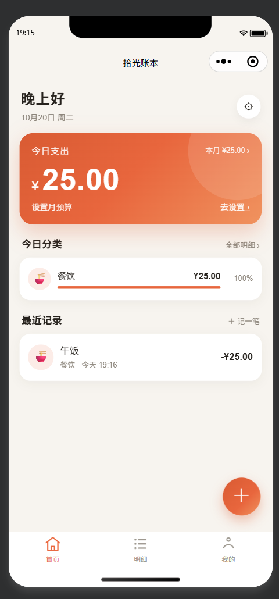
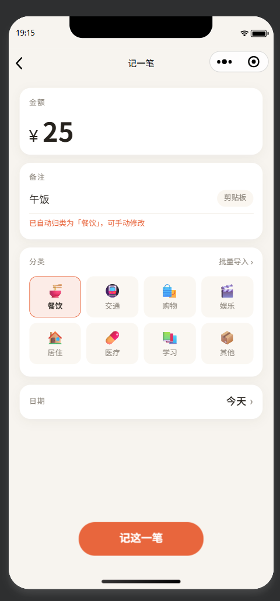
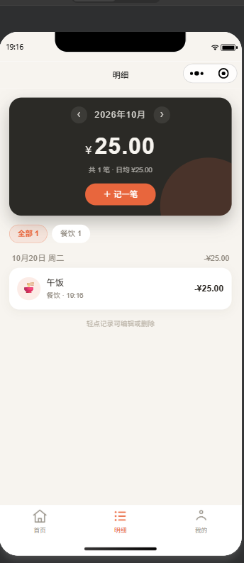
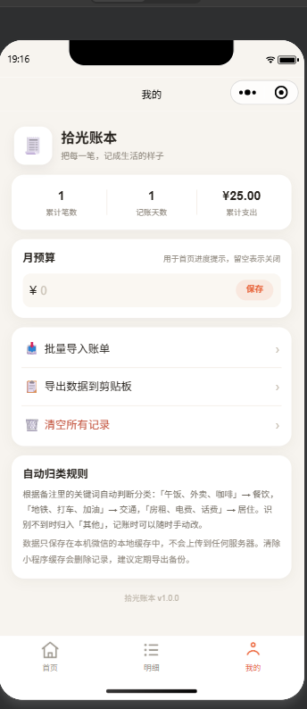

# 拾光账本本 · 微信小程序

一个原生微信小程序记账应用：输入「午饭 25」，自动识别金额、归类为餐饮，并把今天的支出自动汇总到首页。

不依赖任何框架和第三方库，用微信开发者工具导入即可运行。

## 功能

- **首页**：今日支出、本月支出、预算进度、今日分类占比、最近记录
- **记一笔**：金额 / 备注 / 分类 / 日期，顶部可切换「支出 / 收入」；输入备注时自动推荐分类；支持从剪贴板识别；备注里用逗号写多笔（如「午饭27.5，奶茶7.5」）可一次记入；可编辑已有记录
- **批量导入**：粘贴多行账单，一次解析多笔；日期可以单独一行作为后续记录的日期；预览、删改后批量入账
- **明细**：按月查看，分类筛选，按天汇总，轻点记录可编辑或删除
- **收入记账**：支持工资、红包、转账、退款等收入分类；「收到红包50」「工资8000」会自动识别为收入，「发红包50」仍算支出；同一句「收到红包50然后午饭花了25」会拆成收入+支出两笔；首页显示今日收入与本月结余
- **拍照识账单**：拍账单/小票照片，云函数调用腾讯云文字识别，自动提取文字后解析入账
- **每日小票**：每天第一次打开时弹出昨日收支小票（支出/收入/结余），设了月预算会显示本月剩余额度
- **我的**：月预算、导出数据到剪贴板、清空记录、自动归类说明
- **桌宠语音记账**：首页小猫点击弹出对话，支持「按住说话」和「点击说话」两种麦克风模式，说话自动识别、归类、入账并语音回复，可撤销
- **桌宠换肤**：内置手绘小猫，支持从相册上传任意图片作为自定义皮肤

## 快速开始

1. 打开 **微信开发者工具**，用小程序管理员/开发者微信扫码登录
2. 导入本文件夹 `wechat-ledger`
3. AppID 已填 `wxd23b1c4d3340a552`（见 `project.config.json`）
4. 点击编译
5. 语音记账优先用「微信同声传译」插件（设置 → 第三方设置 → 插件管理 → 添加）；若搜不到，改用云开发方案（见下文「云开发语音方案」）

## 桌宠语音记账

- 首页左下角的小猫就是桌宠：点它打开对话面板
- **按住**麦克风按钮说话，松开自动识别：「昨天午饭25」「记账，打车18」「午饭27.5，奶茶7.5」都能识别
- 识别结果自动解析日期、金额、分类并直接入账，小猫语音回复「已记入昨天，午饭 25 元，归为餐饮」
- 记错了可以点「撤销上一笔」
- 语音识别与合成优先用微信官方「同声传译」插件；插件不可用时自动走「云开发 + 腾讯云语音识别」方案

### 云开发语音方案（插件搜不到时）

1. 后台「开发 → 云开发」开通（基础版有免费额度），记下环境 ID
2. 腾讯云实名，开通「语音识别」和「语音合成」
3. 获取 SecretId / SecretKey，写入 `cloudfunctions/voice/config.json`（或配置到云函数 `voice` 的环境变量 `TENCENT_SECRET_ID` / `TENCENT_SECRET_KEY`）
4. 在腾讯云控制台开通「文字识别」（拍照识账单用），有免费额度
5. 在开发者工具中右键 `cloudfunctions/voice` →「上传并部署：云端安装依赖」
5. `app.js` 中 `CLOUD_ENV` 留空使用默认环境；有多个环境时填入环境 ID
6. 隐私保护指引中声明「麦克风」

### 桌宠换肤

- 位置：「我的 → 桌宠换肤」，点任意皮肤立即生效，首页桌宠同步更换
- 内置 1 套手绘小猫皮肤；其他形象点「自定义」从相册上传（图片只存本机）
- 想用其他人物形象：点「自定义」从相册选图，图片只保存在手机本机、不随小程序发布，可规避版权问题

## 关于「自动收集今天花费」

微信**不会**向小程序开放个人微信支付 / 银行卡流水（只有商户 API，且需要商户资质）。所以这里的「自动收集」采用可落地的实现：

1. **自动识别金额**：从文本中提取 `¥12`、`25元`、`1,280.50`、`打车 23.5` 等写法
2. **自动归类**：按备注关键词判断分类，识别不到归入「其他」
3. **自动汇总**：首页按天、按月、按分类实时汇总，无需手算

支持直接粘贴账单文本或支付短信内容，也支持从剪贴板一键识别。

### 解析示例

| 输入 | 结果 |
| --- | --- |
| `午饭 25` | 餐饮 ¥25.00 |
| `打车 23.5` | 交通 ¥23.50 |
| `地铁4元` | 交通 ¥4.00 |
| `¥12.00 早餐` | 餐饮 ¥12.00 |
| `2026-10-02 房租 2500` | 居住 ¥2500.00（日期为 10 月 2 日） |
| `10月1日 火锅 128` | 餐饮 ¥128.00 |
| `昨天 电影票 45` | 娱乐 ¥45.00 |
| `买了2杯咖啡 36` | 餐饮 ¥36.00（多个数字时取最大金额） |
| `午饭27.5，奶茶7.5` | 拆成两笔：餐饮 ¥27.50 + 餐饮 ¥7.50，可一次记入 |
| 单独一行 `2026-10-18` | 作为后续记录的日期，直到下一个日期行 |
| 单独一行 `昨天` | 后续未写日期的记录都记为昨天 |

没有日期的行默认记为今天；`;`、`；`、换行，以及**每段都带金额时的逗号**都可以分隔多笔。`1,280.50` 这种千分位不会被误拆。单独一行的 `2026-10-18`、`2026.10.18`、`昨天`、`今天`、`前天` 会作为后续记录的日期。

### 自动归类规则（节选）

| 分类 | 关键词 |
| --- | --- |
| 餐饮 | 早餐、午饭、晚饭、外卖、咖啡、奶茶、火锅、食堂、零食… |
| 交通 | 地铁、公交、打车、滴滴、高铁、机票、停车、加油… |
| 购物 | 淘宝、京东、超市、商场、衣服、鞋、日用品… |
| 娱乐 | 电影、游戏、KTV、会员、健身、旅游、门票… |
| 居住 | 房租、房贷、水费、电费、燃气、物业、话费… |
| 医疗 | 医院、买药、挂号、体检、牙医、医保… |
| 学习 | 买书、课程、培训、学费、文具、网课… |
| 其他 | 未命中任何关键词 |

规则在 `utils/categories.js` 的 `keywords` 中，直接改数组即可扩展。

## 目录结构

```
wechat-ledger/
├── app.js / app.json / app.wxss
├── project.config.json
├── sitemap.json
├── assets/tab/                 # tabBar 图标（脚本生成，81×81 PNG）
├── docs/screenshots/           # 运行截图（不参与打包）
├── utils/
│   ├── categories.js           # 分类、关键词、汇总
│   ├── parse.js                # 金额/日期/备注解析
│   ├── store.js                # 本地存储 CRUD
│   └── format.js               # 金额与日期格式化
├── pages/
│   ├── index/                  # 首页
│   ├── add/                    # 记一笔 / 编辑
│   ├── list/                   # 明细
│   ├── import/                 # 批量导入
│   └── settings/               # 我的
└── tests/run.js                # Node 单测（不参与打包）
```

## 数据存储

账目数据全部使用微信本地缓存；除语音识别走微信官方「同声传译」插件外，没有任何网络请求：

- `ledger.records.v1`：记录数组
- `ledger.budget.v1`：月预算（单位为分）

单条记录结构：

```js
{
  id: 'm1abc...',
  amount: 2500,          // 单位：分，避免浮点误差
  type: 'expense',       // expense 支出 / income 收入
  category: 'food',
  note: '午饭',
  ts: 1760000000000,     // 记账时间
  createdAt: 1760000000000
}
```

> 清除小程序缓存会删除数据。可在「我的 → 导出数据到剪贴板」定期备份 JSON。

## 测试

```bash
node tests/run.js
```

覆盖：分类、汇总、金额格式化、文本解析（含日期、日期行上下文与多数字）、存储增删改查、按日/月过滤、预算、示例数据、页面清单与 WXML 事件绑定完整性。

当前结果：**39 项全部通过**。

## 运行截图

| 首页 | 记一笔（自动归类） |
| --- | --- |
|  |  |

| 明细 | 我的 |
| --- | --- |
|  |  |

## 已验证 / 未验证

已在 **微信开发者工具 2.02.2609231（游客模式）** 中实际导入、编译并操作：

- ✅ 首页、记一笔、明细、我的四个页面渲染正常
- ✅ 输入金额 `25`、备注 `午饭`，自动归类为「餐饮」并提示「已自动归类」
- ✅ 保存后首页立即显示今日支出 `¥25.00`、餐饮占比 `100%`、最近记录「午饭」
- ✅ 明细页按日期分组显示「10月20日 周二 / -¥25.00」，分类筛选正常
- ✅ 删除记录后首页恢复 `¥0.00` 空账本状态
- ✅ 一条备注写「午饭27.5，奶茶7.5」会拆成两笔、合计 ¥35.00，可一次记入（解析单测覆盖）
- ✅ 批量导入支持单独一行日期：`2026-10-18`、`2026.10.18`、`昨天` 会作用于后续记录
- ✅ 已用真实 AppID `wxd23b1c4d3340a552` 通过 `cli preview` 预览构建成功（包大小 119.9 KB），生成手机预览二维码
- ✅ Node 单测 39 项通过（分类、解析、存储、多笔拆分、日期上下文、语音指令、中文数字、收入识别、混合收支、换肤资源、格式化）
- ✅ 桌宠与语音面板已接入：按住说话 → 识别 → 解析 → 自动入账 → 语音回复 → 可撤销（解析逻辑单测覆盖）
- ⚠️ 语音识别需先在后台添加「微信同声传译」插件，尚未真机验证
- ⚠️ 真机预览/上传需微信扫码登录（开发版可通过体验版测试）

## 可以继续加

- 云开发同步 / 多端备份
- 预算超支提醒（订阅消息）
- 图表统计（周/月趋势、分类环图）
- CSV / 微信支付账单文件导入
- 小票 OCR（需第三方云服务）
- 周期性账单（房租、订阅自动入账）
